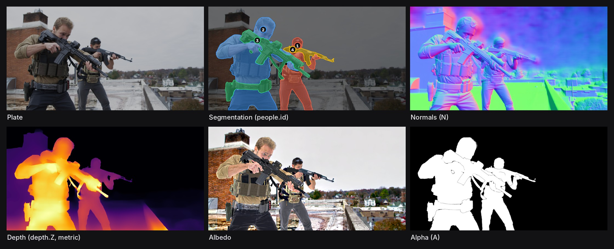
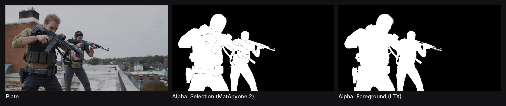
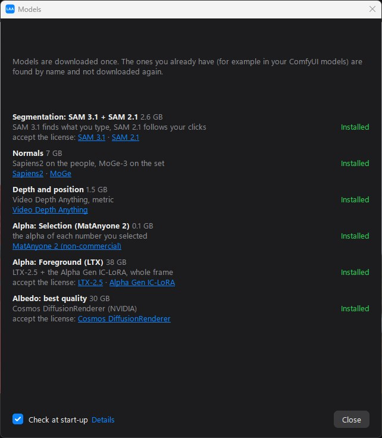
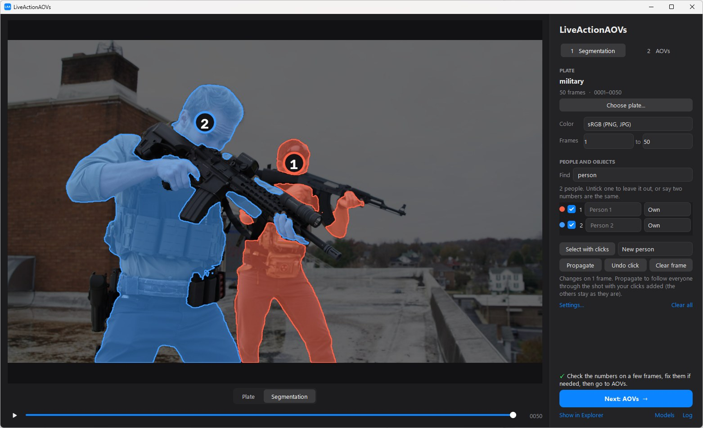
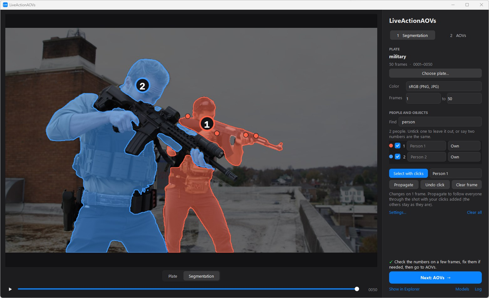
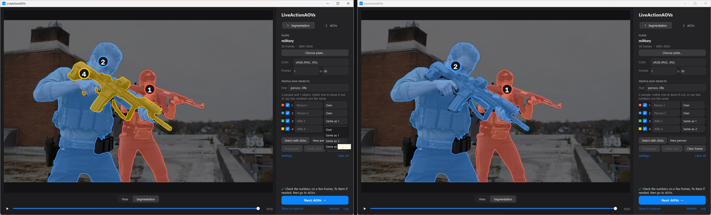
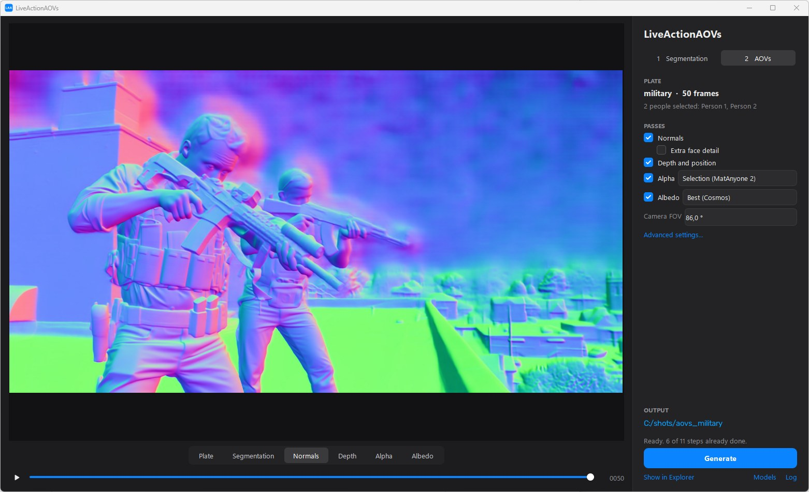
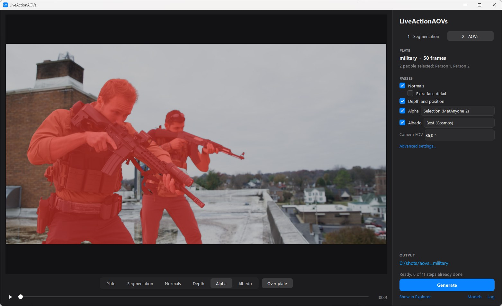

# LiveActionAOVs (LAA)

**AOVs from live-action plates, ready for Nuke.** Pick a plate, check who is who, press Generate:
every frame comes out as one multi-layer EXR with

| layer | what | made with |
|---|---|---|
| `N` | camera-space normals | Sapiens2 on people, MoGe-3 on the set, flicker removed with RAFT |
| `depth.Z`, `P` | metric depth and position | Video Depth Anything (metric), whole shot at once |
| `A`, `alpha_<n>.A` | alpha of what you selected, and one per number | MatAnyone 2 on each SAM mask; or LTX-2.5 Alpha Gen (foreground) |
| `albedo` | base color (optional) | Cosmos DiffusionRenderer (NVIDIA), or Marigold |
| `people.id` | 0 = nobody, 1, 2… one number per person | SAM 3.1 + SAM 2.1 |

It is a desktop app (PySide6), not a ComfyUI workflow: each model is loaded and called directly in
Python, one at a time, so a 24 GB card is enough. A few models (MoGe-3, LTX-2.5, SAM 3.1) only
exist in ComfyUI's code, so LAA imports that code **as a library** (no server, no web UI).

**Two alpha modes.** *Selection* (MatAnyone 2) mattes exactly what you selected on page 1: here the two
soldiers and their rifles, one layer per number. *Foreground* (LTX) is "automatic": the model decides
by itself what the foreground is. It has no prompt or mask input, so you cannot choose what it keeps.

Plate: [ActionVFX](https://www.actionvfx.com). One frame of a 50-frame shot, every pass written to the same EXR.

## Requirements

- Windows 10 / 11, NVIDIA GPU with **24 GB** of VRAM (less may work with lighter settings), recent NVIDIA driver
- [git](https://git-scm.com), and [uv](https://docs.astral.sh/uv/) or Python 3.13
- ~50 GB of disk for the models (~80 GB with Cosmos). If you already use ComfyUI, the models you
  have are reused.
- Room for the cache next to your plate: ~50 MB per 2K frame (a few GB per shot).

## Install

1. `git clone https://github.com/Mariolepipe/LiveActionAOVs.git` (or *Code > Download ZIP*, then extract it)
2. **`setup.bat`**: creates the app's own Python environment (`.venv`, your ComfyUI one is not
   touched), installs PyTorch 2.12 + CUDA 13.0, then:
   - finds your ComfyUI (desktop app, portable, git clone…) and reuses its `models` folders,
     **or** downloads ComfyUI `v0.39.2` into `vendor/ComfyUI` if you have none;
   - downloads the official code of Sapiens2, Video Depth Anything, SAM 2.1 and Materia into `vendor/`.

   Everything it found is written to `config.json` (edit it to add model folders). It also makes a
   **LiveActionAOVs** shortcut (LAA icon) on your Desktop; `make_shortcut.bat` makes it again.
3. **`run.bat`** or the shortcut (no console window; `run_debug.bat` opens the app with one, to see
   everything it prints). At start-up the **Models** window lists what each pass needs, what is
   already on your PC, and downloads the rest with one click. It is also at the bottom right of the
   app, next to *Log*.

   

   Some models are **gated** (SAM 3.1, LTX-2.5, Cosmos): their authors want you to accept their
   license first. The window links their Hugging Face page: log in, accept the license, then create
   a READ token ([huggingface.co/settings/tokens](https://huggingface.co/settings/tokens)) and paste
   it when the app asks. It is how Hugging Face knows the download comes from an account that
   accepted the license. The token is not saved by LAA (tick *Remember* to let Hugging Face keep it,
   like ComfyUI does). The other models download without one.

### Models

Each model keeps its own license. Some are non-commercial or gated: read them before using LAA on
paid work. LAA does not ship any weights.

| used for | model | where |
|---|---|---|
| people numbers | SAM 3.1 | [Comfy-Org/sam3.1](https://huggingface.co/Comfy-Org/sam3.1) |
| people tracking | SAM 2.1 Hiera Large | [facebookresearch/sam2](https://github.com/facebookresearch/sam2) (Apache-2.0) |
| people mask, normals | Sapiens2 1b seg + normal | [facebook/sapiens2](https://huggingface.co/facebook) (`sapiens2-seg-1b`, `sapiens2-normal-1b`) |
| set normals, camera | MoGe-3 ViT-G | [Comfy-Org/MoGe](https://huggingface.co/Comfy-Org/MoGe) (`moge_3_vitg_fp16`) |
| depth | Video Depth Anything metric L | [depth-anything/Metric-Video-Depth-Anything-Large](https://huggingface.co/depth-anything/Metric-Video-Depth-Anything-Large) |
| alpha (Selection) | MatAnyone 2 | [pq-yang/MatAnyone2](https://github.com/pq-yang/MatAnyone2) (S-Lab License, non-commercial) |
| alpha (Foreground) | LTX-2.5 distilled int8 + Gemma text encoder + VAE | [Lightricks/LTX-2.5](https://huggingface.co/Lightricks/LTX-2.5) (gated) |
| alpha (Foreground) | LTX-2.5 IC-LoRA Alpha Gen | [Lightricks/LTX-2.5-22b-IC-LoRA-Alpha-Gen](https://huggingface.co/Lightricks/LTX-2.5-22b-IC-LoRA-Alpha-Gen) (gated) |
| albedo | Cosmos DiffusionRenderer inverse + VAE | [nvidia on Hugging Face](https://huggingface.co/nvidia) (gated) |
| albedo (lighter) | Marigold IID | [prs-eth/marigold-iid-appearance-v1-1](https://huggingface.co/prs-eth/marigold-iid-appearance-v1-1) (downloaded on first use) |

## Use

The app has two pages, like [Sammie-Roto](https://github.com/Zarxrax/Sammie-Roto).

### 1 · Segmentation

Choose one frame of the plate (EXR, PNG, JPG… or a folder), its color space (sRGB, linear, ACEScg)
and, if you want, the frame range. It loads in the background and you can start right away.

**Find** (SAM 3.1) finds what you type, in English, comma separated (for example `person`, or
`person, car, house`), then SAM 2.1 tracks each one through the shot. Each one gets a number and a colour.

**Select with clicks** fixes or adds what Find missed. Pick who in the list next to the button,
then click on the frame: **left click = add, right click = remove**, the result shows at once.
On someone Find already found, a left click adds the part under it (here the rifle the soldier at
the back holds) and everyone else stays as found. Every frame you click on becomes a keyframe;
**Propagate** tracks everyone through the shot, forward and backward from your keyframes.
Wrong further on? Go there, click, Propagate. *New person* / *New object* add someone or something
Find did not see.

**Same as** merges two numbers: they become one number, one alpha, one `people.id`. Useful for what
a person holds: find it as an object (`person, rifle`), then set it to *Same as* the soldier holding
it. The rifle is part of their matte, and it stays an object for the normals: MoGe does it, not
Sapiens (which only knows bodies). Keep what belongs together on one number: two numbers that touch
are matted separately.

Anything found that is not a person (a rifle, a car, a house) is an **object**: tracked the same way,
with an alpha and a `people.id` number, but no Sapiens body crop (its normals come from MoGe).
Untick a number to leave it out. Give names if you want (type them next to the number): the EXRs
carry a `people/names` header that maps each `people.id` value to its name. **Clear all** starts
again from nothing. Then **Next: AOVs**.

### 2 · AOVs

Tick the passes you want, press **Generate**. Each step runs on the whole shot and is cached in
`<output>/_cache/`: change one setting and only the steps that depend on it run again. **Cancel**
stops at once (the job runs in its own process). The viewer follows the step being computed;
mouse wheel = zoom, F = fit, arrows = frames, Space = play.

On the Alpha view, **Over plate** shows the alpha in red over the plate, to check its edges.

**Output**: `<output>/<name>_aovs.<frame>.exr` with the plate's frame numbers, half float by
default. In Nuke: a Read with *raw data* ticked, then Shuffle the layers.

**Advanced settings** has every knob (crop margins, MoGe detail, LTX chunk size…), and a
**developer mode** that shows the inner steps in the viewer (Sapiens body parts, crops, MoGe vs
Sapiens normals, blend mask, stabilization checks…).

Batch mode, without the window (for scripts or a farm, no clicks: Find only):
`run_cli.bat --input "C:\shots\plate.####.exr" --colorspace acescg` (`--list-settings` prints every setting).

## How it works

| step | model | |
|---|---|---|
| plate | | reads the plate, converts it to the display-referred sRGB the models expect |
| people | SAM 3.1 → SAM 2.1 | one number per person through the whole shot, checked by you |
| seg | Sapiens2 seg | people and head pixels |
| crops | Sapiens2 normal | normals on one crop per person and per head, at native resolution, blended back |
| moge | MoGe-3 | normals of the set, depth, camera (fixed FOV) |
| merge | | Sapiens inside the people, MoGe elsewhere, axis signs matched once for the shot |
| stabilize | RAFT | optical-flow compensated temporal average, with anti-ghosting |
| depth | Video Depth Anything metric | stable metric depth, whole shot at once |
| alpha | MatAnyone 2 / LTX-2.5 Alpha Gen | **Selection**: MatAnyone 2 follows each number from its SAM mask, so the alpha is exactly what you selected, one layer per number. **Foreground**: LTX on the whole frame decides by itself what the foreground is (it has no prompt or mask input). Or Sapiens2 matting / segmentation |
| albedo | Cosmos DiffusionRenderer | 57-frame video model, so it is stable; or Marigold |
| write | | multi-layer EXR + FOV / focal length metadata |

**Cosmos on Windows.** NVIDIA's code needs Linux. LAA uses [Materia](https://github.com/NicholaiVogel/comfyui-materia)
(Biohazard VFX), a pure-PyTorch port that runs natively. Plan B: the official NVIDIA code in WSL
(`cosmos/install_wsl.bat`, then `cosmos/setup_cosmos.bat`, then Advanced > Cosmos runs > In WSL).

**Known limits.** MoGe struggles with the sky around people (visible in N; you rarely need N on the
sky: relight the people through the alpha). MatAnyone 2 was trained on people: on objects it is
good but less refined. The Foreground mode (LTX) cannot be told what to matte.

## Develop

- `tests/` run the whole pipeline and the UI with fake models (no weights, CPU):
  `python tests/test_fake_pipeline.py`, `tests/test_people.py`, `tests/test_ui_runner.py`, `tests/test_ui_people.py`.
- Add a pass: a model adapter in `laa/models/`, a `step_<name>` in `laa/pipeline.py` with its line
  in `STEPS` (settings and upstream steps it depends on), its layers in `step_write`.
- Test a first install on your own PC: `set LAA_FRESH_TEST=1` (and `HF_HOME` to an empty folder) before
  `setup.bat` / `run.bat`: your ComfyUI and models are not detected, the app starts with fresh settings.

## Credits

Built by [Mario Falco](https://github.com/Mariolepipe), with [Claude](https://claude.ai).
Thanks to the authors of SAM 2 / SAM 3 (Meta), Sapiens2 (Meta), MoGe (Microsoft), Video Depth
Anything (ByteDance), MatAnyone 2 (NTU S-Lab), LTX-2.5 (Lightricks), Cosmos DiffusionRenderer (NVIDIA), Marigold (ETH Zürich),
RAFT (Princeton), [ComfyUI](https://github.com/Comfy-Org/ComfyUI), [Materia](https://github.com/NicholaiVogel/comfyui-materia)
and [Sammie-Roto](https://github.com/Zarxrax/Sammie-Roto) for the two-page idea.
Test plates: [ActionVFX](https://www.actionvfx.com).

## License

GPL-3.0 (see `LICENSE`), because the native Cosmos backend uses Materia (GPL-3.0). The models are
not part of this repository and keep their own licenses.
